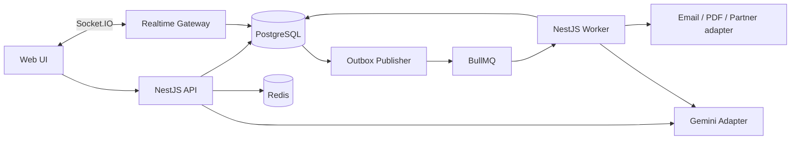

# 02 — Dữ liệu và kiến trúc ứng dụng

## 1. Kiến trúc lựa chọn

DEC: monolith theo module, controller → application/service → repository. Controller không gọi SQL/ORM trực tiếp. Domain service không phụ thuộc HTTP response hoặc SDK Gemini. Transaction nằm ở use case điều phối.

So với microservices, mô hình này giữ checkout/tồn/outbox trong một DB transaction, ít thành phần vận hành. Monolith không chia module sẽ dễ bắt đầu hơn nhưng khó kiểm soát quyền và test. Chọn monolith chia module; chưa cần event broker ngoài Redis/BullMQ.

REQ stack: NestJS 10, Node.js 20, TypeScript, PostgreSQL 16, Redis 7. DEC ORM dùng TypeORM với migration; không bật synchronize ngoài DB test dùng một lần. UI React + TypeScript + Vite. Các phiên bản thư viện cụ thể xác minh khi scaffold; không tự nâng major stack bắt buộc trong SRS.

DEC môi trường: máy Windows phát triển không dùng Docker Desktop hoặc WSL. PostgreSQL 16 chạy native; cache/queue dùng Memurai native tương thích Redis API v7. Production/VPS vẫn chạy Redis 7 thật theo SRS. M0 phải chạy contract smoke cho Lua, Pub/Sub, delayed jobs, retry và BullMQ trên Memurai; M7/M8 chạy lại integration suite với Redis 7 để phát hiện khác biệt implementation.



Outbox publisher đọc DB bằng polling, claim batch có lease và SKIP LOCKED, enqueue bằng eventId ổn định; chỉ đánh dấu published sau enqueue. Crash giữa enqueue và đánh dấu được xử lý bằng jobId và consumer dedup. Gateway nhận sự kiện order qua kênh nội bộ Redis; nếu bỏ lỡ thì client REST resync.

## 2. Module contracts

| Module     | Sở hữu                           | Interface cho module khác                  |
| ---------- | -------------------------------- | ------------------------------------------ |
| Auth/Users | User, session, OTP               | verifyPrincipal, requireRole               |
| Catalog    | Category, Brand, Product         | getPurchasableProducts, updateProduct      |
| Inventory  | Inventory, reservation, movement | reserve, release, consume, adjust          |
| Cart       | CartItem                         | getCart, subtractPurchasedItems            |
| Orders     | Order, items, history, payment   | placeOrder, transition, getAuthorizedOrder |
| Promotions | Promotion, redemption            | validateAndRedeem                          |
| Tickets    | Ticket, message                  | claim, reply, getAuthorizedContext         |
| AI         | AI session/message/proposal      | classifyTicket, assist, confirmProposal    |
| Jobs       | Outbox, execution, failed job    | enqueueFromOutbox, retryFailed             |
| Runtime    | Cache, limiter, health, metrics  | infrastructure adapters                    |

Không dùng repository của module khác từ controller. Cross-module use case gọi service có contract và truyền transaction context khi cần nguyên tử.

## 3. Quy ước dữ liệu

UUID cho ID nội bộ; mã đơn public unique dạng SF + ngày + suffix ngẫu nhiên, không dựa vào số thứ tự để phân quyền. createdAt/updatedAt timestamptz. Tiền BIGINT với constraint không âm; API chỉ trả số trong giới hạn safe integer. Quantity integer có constraint. Các bảng thay đổi đồng thời có version tăng đơn điệu.

## 4. Bảng và ràng buộc chính

| Bảng                  | Trường chính ngoài ID/timestamps                                                                                                              | Ràng buộc/index                                                                |
| --------------------- | --------------------------------------------------------------------------------------------------------------------------------------------- | ------------------------------------------------------------------------------ |
| users                 | email, passwordHash, role, status, emailVerifiedAt                                                                                            | unique email; role enum, ACTIVE/DISABLED                                       |
| auth_sessions         | userId, tokenFamilyId, refreshHash, expiresAt, revokedAt                                                                                      | unique refreshHash; index userId                                               |
| refresh_token_history | sessionId, tokenHash, usedAt, expiresAt                                                                                                       | unique tokenHash; giữ hash token đã rotate đến hết hạn để phát hiện reuse      |
| verification_codes    | userId, codeHash, expiresAt, attempts, consumedAt                                                                                             | index userId/createdAt; chỉ mã mới nhất hợp lệ                                 |
| categories            | name, slug, active                                                                                                                            | unique slug                                                                    |
| brands                | name, slug, active                                                                                                                            | unique slug                                                                    |
| products              | sku, slug, name, description, imageUrl, categoryId, brandId, price, active, version                                                           | unique sku/slug; index active/categoryId/price/id và active/brandId/price/id   |
| inventories           | productId, onHand, reserved, version                                                                                                          | unique productId; check 0 <= reserved <= onHand                                |
| cart_items            | userId, productId, quantity                                                                                                                   | unique userId/productId; quantity 1–99                                         |
| orders                | code, customerId, status, paymentStatus, subtotal, discount, total, addressSnapshot JSONB, promoId, expiresAt, version                        | unique code; index customerId/createdAt/id, status/createdAt, status/expiresAt |
| order_items           | orderId, productId, skuSnapshot, nameSnapshot, unitPrice, quantity, lineTotal                                                                 | unique orderId/productId; FK product restrict                                  |
| reservations          | orderItemId, productId, quantity, status                                                                                                      | unique orderItemId; ACTIVE/RELEASED/CONSUMED                                   |
| inventory_movements   | productId, orderId nullable, actorId nullable, deltaOnHand, deltaReserved, reason, businessKey                                                | unique businessKey; index productId/createdAt                                  |
| order_status_history  | orderId, fromStatus, toStatus, actorId nullable, source, reason, orderVersion                                                                 | unique orderId/orderVersion                                                    |
| payments              | orderId, provider, status, amount, paidAt, refundedAt                                                                                         | unique orderId; provider MOCK                                                  |
| promotions            | code, amount, minOrderAmount, startsAt, endsAt, totalQuota, usedCount, active                                                                 | unique code; usedCount <= totalQuota                                           |
| promotion_redemptions | promotionId, customerId, orderId                                                                                                              | unique promotionId/customerId; unique orderId                                  |
| idempotency_records   | userId, route, key, requestHash, statusCode, response JSONB, expiresAt                                                                        | unique userId/route/key                                                        |
| tickets               | customerId, orderId nullable, subject, status, category, classificationStatus, classificationSource, assignedTo nullable, resolvedAt, version | index assignedTo/status/createdAt; customerId/createdAt                        |
| ticket_messages       | ticketId, authorId, body, source                                                                                                              | index ticketId/createdAt/id; source HUMAN/AI_APPROVED                          |
| ai_sessions           | ticketId, agentUserId, model, promptVersion, expiresAt                                                                                        | index ticketId/agentUserId                                                     |
| ai_messages           | sessionId, role, content JSONB, toolCallId nullable                                                                                           | index sessionId/createdAt/id                                                   |
| ai_proposals          | sessionId, ticketId, actorId, action, payload JSONB, expectedVersion, status, expiresAt, executedAt                                           | PENDING/EXECUTED/REJECTED/EXPIRED; immutable payload                           |
| outbox_events         | type, aggregateId, aggregateVersion, payload JSONB, availableAt, publishedAt, leaseUntil, attempts                                            | unique event business key; index publishedAt/availableAt                       |
| job_executions        | businessKey, type, status, leaseUntil, resultRef, lastError                                                                                   | unique businessKey                                                             |
| failed_jobs           | originalJobId, businessKey, queue, payload JSONB, attempts, reason, failedAt, retriedAt                                                       | index queue/failedAt; redacted payload                                         |
| invoices              | orderId, documentVersion, storageKey, checksum, status                                                                                        | unique orderId/documentVersion                                                 |
| audit_logs            | actorId nullable, action, entityType, entityId, requestId, changes JSONB                                                                      | index entityType/entityId/createdAt                                            |
| security_counters     | scope, subjectHash, windowStart, count, blockedUntil                                                                                          | unique scope/subjectHash/windowStart; fallback limiter nhạy cảm khi Redis lỗi  |

Các FK quan trọng dùng RESTRICT; không cascade xóa lịch sử đơn hoặc audit. expiresAt dùng cleanup định kỳ nhưng không dùng cleanup làm cơ chế đảm bảo hiệu lực token/key.

## 5. Giao dịch bắt buộc

1. Checkout: order + items + reservation + inventory + promo redemption + cart + history + outbox + idempotency. Outbox chứa version sản phẩm/tồn cần vô hiệu cache sau commit.
2. Transition order: khóa order, validate version/state, inventory/payment liên quan + history + audit + outbox. Payment thành công tạo outbox invoice; thay đổi tồn tạo outbox cache invalidation.
3. Update product/inventory: entity + version + movement/audit + outbox cache invalidation cho đúng product/category/brand liên quan.
4. Confirm AI proposal: khóa proposal, xác thực lại người dùng/context và version, thay đổi ticket + audit + proposal EXECUTED trong một transaction.

Deadlock/serialization retry tối đa 2 lần cho transaction chưa commit với cùng business key. Timeout DB trả lỗi có requestId, không retry vô hạn.

## 6. Tổ chức source dự kiến

```text
apps/api/             bootstrap HTTP + realtime
apps/worker/          bootstrap jobs + outbox + schedules
apps/web/             customer/staff UI
libs/modules/         auth, catalog, inventory, cart, orders, promotions, tickets, ai
libs/platform/        database, redis, cache, queue, logging, metrics
libs/contracts/       DTO/schema/event types chia sẻ, không chứa secret
database/migrations/
database/seeds/
tests/integration/
tests/e2e/
docs/evidence/
```

Đây là cấu trúc đề xuất, không yêu cầu tạo microservice hoặc package độc lập cho mỗi module.
