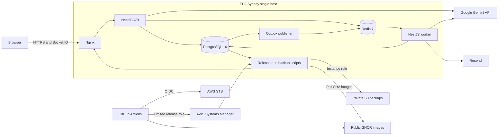

# 20 — Bàn giao và trạng thái nghiệm thu

Ngày 28/10/2026, Asia/Bangkok. Release được kiểm chứng: `d4fe2524d32fcd8c2cbe624e011b97279162d97a`. Không tuyên bố toàn bộ SRS PASS khi Gemini còn lỗi và quyền quản trị chưa được xác minh đủ.

## Mở để nghiệm thu

- [Ứng dụng HTTPS](https://shopfast.tuanpq.com).
- [Cấu trúc repository](19-repository-structure.md), [runbook](14-deployment-runbook.md), [harness](17-harness-guide.md).
- [Slide HTML/PDF](defense/README.md), [kịch bản 10 phút và Q&A](18-defense-walkthrough.md).
- [Bundle mới:153receipts và57artifacts](evidence/runs/6c3f6721a10793df/manifest.json): assertion, source test, log, coverage JSON, ảnh browser synthetic đã review, performance, S3 restore và cả kết quả FAIL. Bundle trước lần retry: [snapshot ban đầu](evidence/runs/5abb9df94b8c1dfa/manifest.json).

Raw artifacts giữ nguyên byte và SHA256. Báo cáo nguồn, SHA thực thi và trạng thái FAIL cũ không được đổi nhãn sang release khác. Các thay đổi bàn giao sau d4fe252 chỉ ở docs/harness/native helpers; `published-artifacts.mjs` kiểm Git tree/blob của apps/libs/database/deploy/tests và cấu hình build/coverage trước khi xác nhận báo cáo tương thích. Phép kiểm publication không biến kết quả AI FAIL thành PASS.

## Kết quả đã chạy

| Nhóm                      | Kết quả thực thi                                                                                                                                                     |
| ------------------------- | -------------------------------------------------------------------------------------------------------------------------------------------------------------------- |
| Required CI của PR13      | application-checks và docs-checks PASS trước merge                                                                                                                   |
| Local CI source sạch      | 68normal tests,137combined tests,3browser tests; typecheck/lint/build PASS                                                                                           |
| Case docs08               | 49/49PASS; các ca AI local dùng test doubles, khác với smoke Gemini thật                                                                                             |
| Memurai và Redis Linux    | Cả hai nền PASS Lua/PubSub/BullMQ/cache contracts                                                                                                                    |
| Runtime và cloud kỹ thuật | 15/15mỗi nhóm PASS; identity gate vẫn BLOCKED                                                                                                                        |
| Git/image secret scan     | 658Git blobs,2image archives,0credential findings sau review fingerprint GnuTLS public self-test keys                                                                |
| Scheduler                 | Worker production chạy đúng entrypoint/hook; JOB-05/JOB-06 PostgreSQL controlled-clock PASS. Không nói báo cáo đêm production đã chạy khi chưa tới ngày đủ điều kiện |
| Deploy với phiên khách    | 58authenticated reads,3socket subscriptions,0errors; rollback5giây; restore release ban đầu                                                                          |
| Worker crash/Redis outage | Injection thật và recovery PASS                                                                                                                                      |
| S3 restore/reboot         | Restore clone7giây,checksum/table counts/login/order/PDF PASS; reboot giữ volume/data/release và HTTPS trở lại                                                       |
| Performance               | Warmup120giây + đo600giây,200kcustomers/10kproducts/100korders;0errors/429                                                                                           |

Performance: catalog30.018mẫu,p95=6,46ms; checkout920mẫu,p95=16,55ms; second-read30mẫu,p95=6,79ms; realtime100mẫu,max=15ms; cache hit96,79%. Generator cùng host; worker fixture không gửi provider traffic. Không coi đây là tải Internet đa vùng hoặc HA.

Coverage source d4fe252: unit lines60,06%,statements59,06%; combined lines86,74%,statements85,22%,functions77,34%,branches70,64%. Raw JSON nằm trong bundle; không nói mọi metric unit vượt60%.

## Những mục chưa đạt

1. **Gemini thật:** primary và secondary key đều trả503UNAVAILABLE; Google báo model đang high demand. Lần retry21:45 vẫn lỗi. Provider/staging tổng giữ FAIL; không đổi model hoặc dùng phản hồi giả. Bốn REQ-F01 live đang FAIL. Sau khi Google phục hồi, chạy lại providers/staging và report theo cùng source/config phù hợp.
2. **Cloud human least privilege:** người dùng xác nhận Builder ID TOTP và fresh-login MFA; nhóm có thành viên, nhưng role human vẫn AdministratorAccess. Workload account bị từ chối sso:ListPermissionSets; người dùng chọn làm phiên Identity Delegated Admin sau. Không dùng access key dài hạn để lách.
3. **Diễn tập và Q&A:** deck/kịch bản đã có; chưa có bằng chứng người dùng diễn tập đủ10phút hoặc tự trả lời Q&A. Đây là phần nghiệm thu của người dùng.

Aggregate trước khi publication hoàn tất:103PASS,4FAIL,4BLOCKED trên111REQ/cases. Một BLOCKED là publication coverage/restore tại thời điểm snapshot; bundle này cung cấp các artifact đó, còn collector publication kiểm public Git commit và compatibility độc lập. Snapshot gốc không bị sửa để ghi PASS sau sự kiện.

## Sửa harness và local đã kiểm chứng

- Hai receipt quality bị đặt nhầm nhãn `business-coverage-report`/`ci-failure-blocks-merge`; đã bổ sung record sửa metadata sang `coverage`/`ci-fail-block`, giữ nguyên command/SHA/time/assertions/hashes. Producer được sửa và thêm regression test từ chối nhãn chưa đăng ký.
- Staging từng chỉ lưu fixture sau AI:503làm test deploy bị chặn dù đơn đã DELIVERED. Lượt độc lập đã xác thực lại login/ownership/order trước khi rehearsal; giữ thời điểm tạo fixture gốc và ghi rõ full staging vẫn FAIL. Producer nay lưu protected fixture ngay sau order/invoice assertions, không miễn AI checks.
- Email component được đánh giá riêng từ report staging thực thi thật, đối chiếu command artifact/freshness/source/config. Email đã hoàn tất không bị đổi thành lỗi chỉ vì bước AI sau đó thất bại; staging tổng vẫn FAIL.
- Local `.env` cũ trỏ55432/6379 trong khi runtime đang5432/16380. Đã chỉnh riêng URL local, giữ provider keys; áp dụng2migration thiếu. Node20dev-doctor PASS PostgreSQL16/Memurai API7.
- Native helpers đọc port cấu hình và start idempotent. Memurai fresh-start/shutdown/restart/persistence đã test ở port16491cô lập rồi dừng instance test; không dừng instance local đang dùng. Không Docker Desktop/WSL.

## Kiến trúc AWS đang chạy

Cloudflare giữ DNS; TLS kết thúc tại Nginx. SG chỉ mở80/443và SSH giới hạn địa chỉ quản trị; DB/Redis chỉ loopback. Không có RDS, ALB hoặc cluster đa host. Giữ nguyên EC2/S3/SSM/OIDC đã cấp; không tạo tài nguyên trả phí mới.
