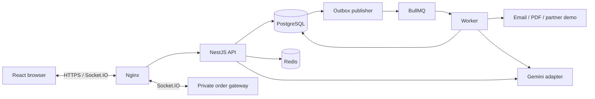

# Hướng dẫn đọc và trình bày dự án ShopFast

Soạn ngày 02/11/2026. Dùng tài liệu này để học luồng code và chuẩn bị phần giải thích; [project tour](22-project-tour.md) là bản mở nhanh thư mục, còn [kịch bản demo](18-defense-walkthrough.md) dành cho thao tác trên ứng dụng.

Khi cần trả lời “phần code này đáp ứng yêu cầu nào của đề?”, mở **mục 16 — bảng đối chiếu SRS, code và minh chứng** ở cuối tài liệu.

## 1. Nắm dự án trong một phút

**ShopFast là backend thương mại điện tử theo kiến trúc monolith chia module**, có UI để demo. Các phần chính: xác thực, sản phẩm/tồn kho, giỏ hàng/đơn hàng, hỗ trợ khách hàng bằng Gemini, realtime, cache/rate limit và tác vụ nền. PostgreSQL giữ dữ liệu nghiệp vụ; Redis phục vụ cache, giới hạn truy cập, queue và truyền tín hiệu.

Có thể mở đầu bằng đoạn này:

> Dự án của em là ShopFast, một hệ thống thương mại điện tử dùng NestJS và PostgreSQL. Ngoài luồng mua hàng, em tích hợp theo dõi đơn realtime, Redis cache/rate limit, BullMQ xử lý nền và Gemini hỗ trợ nhân viên chăm sóc khách hàng. Em tổ chức monolith theo module để giữ đơn hàng, tồn kho và outbox trong cùng transaction. API, worker và frontend có entrypoint riêng.

Đọc trước [SRS gốc](../Module%2006%20–%20Software%20Requirement%20Specification%20%28SRS%29.docx.txt), [product spec](01-product-spec.md) và [kiến trúc dữ liệu](02-data-architecture.md). Phân biệt yêu cầu của đề với quyết định bổ sung của dự án; không gọi mọi DEC là yêu cầu nguyên văn SRS.

## 2. Hiểu cây thư mục trước khi đọc từng dòng

| Thư mục             | Vai trò                                                                    | Cách giải thích                                       |
| ------------------- | -------------------------------------------------------------------------- | ----------------------------------------------------- |
| `apps/api`          | Chạy HTTP API và tích hợp realtime                                         | Nơi khởi động và ghép module                          |
| `apps/worker`       | Chạy worker, scheduler, outbox processing                                  | Tách vòng đời xử lý nền khỏi request                  |
| `apps/web`          | React, TypeScript, Vite                                                    | Client gọi HTTP/Socket.IO, không giữ key Gemini       |
| `libs/modules`      | Các module auth/catalog/orders/tickets/ai/jobs/runtime/realtime/operations | Chia theo trách nhiệm nghiệp vụ hoặc hạ tầng ứng dụng |
| `libs/platform`     | Database, config, health, outbox dùng chung                                | Hạ tầng chung, không phụ thuộc ngược module nghiệp vụ |
| `database`          | Migration và seed                                                          | Constraint và lịch sử thay đổi DB                     |
| `tests`             | Unit, contract, integration, runtime, browser                              | Kiểm tra rule, lỗi, race và hành vi người dùng        |
| `harness`           | Chạy kiểm chứng, gom assertion/artifact/receipt                            | Kết quả phải có phạm vi và SHA                        |
| `deploy`            | Docker Linux, Nginx, release, backup, vận hành                             | Code triển khai và khôi phục                          |
| `.github/workflows` | CI và release pipeline                                                     | Kiểm tra PR, build image và triển khai                |
| `docs`              | Spec, quyết định, runbook và evidence                                      | Giải thích thiết kế và minh chứng                     |

Trong một module, đọc theo thứ tự:

```text
http/controller + DTO
        ↓
application/service        quyền nghiệp vụ, validation, transaction, orchestration
        ↓
persistence/repository     SQL và truy cập dữ liệu bằng executor được truyền xuống

composition/runtime        dựng service/adapter, quản lý kết nối và shutdown
adapters                   Gemini, email, PDF hoặc gateway khi module cần
*.module.ts                Nest wiring
*.contracts.ts             type/error contract
```

Không phải module nào cũng cần đủ tất cả thư mục. Đừng giải thích rằng cứ có nhiều tầng hoặc nhiều folder là tự động đạt Clean Code; hãy chỉ vào trách nhiệm và hướng phụ thuộc thực tế.

## 3. Đường đi tổng thể của hệ thống



Khi trình bày, nói rõ đây là sơ đồ logic. Thực tế production hiện tại đặt các thành phần trên một EC2; không phải một cụm nhiều máy hoặc hệ thống HA. Chi tiết mạng, proxy và entrypoint xem [runbook](14-deployment-runbook.md).

## 4. Đọc entrypoint và phần xử lý chung

Mở lần lượt:

1. [API main](../apps/api/src/main.ts): điểm chạy API.
2. [API bootstrap](../apps/api/src/bootstrap.ts): ghép module, validation, xử lý lỗi, response envelope và lifecycle. Tìm `createApiApp`, `ValidationPipe`, `requestId`.
3. [Data source](../libs/platform/src/database/data-source.ts): cấu hình PostgreSQL và migration.
4. [Worker main](../apps/worker/src/main.ts) rồi [FoundationWorker](../apps/worker/src/foundation-worker.ts): khởi tạo và shutdown tiến trình nền.

Điểm cần nói: request có validation và response/lỗi thống nhất; không để mỗi controller tự định dạng tùy ý. Swagger được bật trong bootstrap khi môi trường không phải production; đừng hứa mở Swagger production nếu cấu hình hiện tại không bật.

## 5. Luồng auth: vì sao route được bảo vệ?

**Thứ tự đọc:** [AuthController](../libs/modules/auth/src/http/auth.controllers.ts) → [DTO](../libs/modules/auth/src/http/auth.dto.ts) → [module auth — tìm lớp AuthService](../libs/modules/auth/src) → [AuthRepository](../libs/modules/auth/src/persistence/auth.repository.ts) → [guards](../libs/modules/auth/src/http/auth.guards.ts).

Tìm trong service: `register`, `confirmVerification`, `login`, `refresh`, `currentUser`, `logout`.

Giải thích bằng luồng: đăng ký → lưu password hash → yêu cầu gửi mã qua outbox/job → xác minh email → sử dụng chức năng cần tài khoản đã xác minh. Access token và session còn được kiểm phía server; refresh token được rotate, lịch sử token phục vụ phát hiện reuse.

Ba lớp guard cần hiểu:

- `AccessGuard`: xác thực principal/session.
- `VerifiedGuard`: yêu cầu email đã xác minh.
- `RolesGuard`: kiểm vai trò được phép gọi route.

**Câu cần nói:** “Guard bảo vệ route; service vẫn kiểm quyền trên tài nguyên cụ thể. Khách hàng đăng nhập không có nghĩa là được đọc đơn của người khác.”

**Minh chứng:** [auth integration](../tests/integration/auth.integration.spec.ts), [auth HTTP](../tests/integration/auth-http.integration.spec.ts), [guard unit tests](../tests/unit/auth-guards.spec.ts).

## 6. Luồng quan trọng nhất: checkout và tồn kho

Mở [OrdersController](../libs/modules/orders/src/http/orders.controllers.ts), sau đó [OrderService](../libs/modules/orders/src/application/order.service.ts). Dùng tìm kiếm trong file với `checkout`, `idem`, `transition`, `expireDue`. Khi cần xem SQL, mở [OrderRepository](../libs/modules/orders/src/persistence/order.repository.ts).

Đọc `checkout` theo thứ tự sau:

1. Kiểm danh sách hàng, số lượng và dữ liệu giá client gửi.
2. Chuẩn hóa request và sắp xếp sản phẩm để giữ thứ tự lock nhất quán.
3. Kiểm idempotency: cùng key/cùng payload trả lại kết quả; payload khác gây conflict.
4. Lock và đọc sản phẩm/tồn kho từ DB; kiểm giá, trạng thái bán, lượng còn khả dụng và promotion.
5. Tạo order, snapshot dòng hàng/địa chỉ, reservation và inventory movement; cập nhật giỏ hàng, quota và payment record.
6. Ghi history và outbox trong cùng transaction; sau đó trả đơn đã lưu.

**Ba ý bắt buộc giải thích được:**

- Giá và tồn kho do server xác nhận; client/cache không quyết định có đủ hàng để bán.
- Order/reservation/outbox cùng commit hoặc rollback; repository không tự mở transaction riêng cho từng query.
- Idempotency giải quyết request gửi lại; version và lock giải quyết các thay đổi đồng thời. Chúng có vai trò khác nhau.

Sau đó đọc `transition`: kiểm ownership/role, expected version và trạng thái được phép chuyển. Khi shipping/cancel/expire, xem cách consume hoặc release reservation và ghi movement.

**Câu cần nói:** “Đặt hàng giữ tồn trước. Thanh toán hiện là mô phỏng; em không tích hợp cổng thanh toán thương mại thật.”

**Minh chứng:** [orders integration](../tests/integration/orders.integration.spec.ts) và [catalog/inventory integration](../tests/integration/catalog.integration.spec.ts). Mở tên case về race, oversell, promotion hoặc replay rồi đọc expected/assertion, không chỉ chỉ vào chữ PASS.

## 7. Realtime: đúng người, đúng đơn và kết nối lại

Mở [OrderRealtime gateway](../libs/modules/realtime/src/adapters/realtime.gateway.ts), tìm `/orders`, `order.subscribe`, `subscribe`, `validate`. Sau đó xem [Orders UI](../apps/web/src/features/orders/orders.tsx).

Luồng cần hiểu: handshake nhận token → xác thực session → client đăng ký đơn → server kiểm quyền đọc đơn → join room phù hợp → nhận `order.status.updated`.

Khi mất mạng, client kết nối lại và đăng ký lại; đọc REST để đồng bộ trạng thái DB. Socket event không thay thế DB và không được broadcast mọi đơn cho toàn bộ khách hàng.

**Minh chứng:** [realtime integration](../tests/integration/realtime.integration.spec.ts), [browser purchase/reconnect](../tests/e2e/catalog-live.e2e.spec.ts), [production continuity](evidence/2026-10-29-structure-production.md).

## 8. Background jobs: vì sao request không phải chờ email/PDF?

Đọc [enqueueOutbox và publisher](../libs/platform/src/outbox/outbox.ts) → [FoundationWorker](../apps/worker/src/foundation-worker.ts) → [JobsService](../libs/modules/jobs/src/application/jobs.service.ts) → [JobsRepository](../libs/modules/jobs/src/persistence/jobs.repository.ts).

Tìm `enqueueOutbox`, `consume`, `tick`, `catchUp`, `execute`, `retryDelay`. Theo một event từ lúc ghi DB đến khi được xử lý; phân biệt outbox event với job execution.

- Outbox giữ dấu vết cần xử lý cùng transaction nghiệp vụ.
- Publisher/queue/worker thực hiện tác vụ ngoài request; job có key và trạng thái bền vững.
- Lease, retry và dedup xử lý lỗi/crash; không chỉ dựa vào một biến trong RAM.
- Scheduler có reminder, expiry và revenue report; kiểm clock/timezone trong code và test.

Mở [Resend adapter](../libs/modules/jobs/src/adapters/resend-email.ts), [invoice renderer](../libs/modules/jobs/src/adapters/invoice.renderer.ts), [retention service](../libs/modules/jobs/src/application/retention.service.ts) nếu hội đồng hỏi sâu.

**Câu cần nói:** “Retry không đồng nghĩa gửi lại side effect vô điều kiện. Email cần idempotency và trạng thái delivery; em không hứa exactly-once tuyệt đối với mọi dịch vụ ngoài.”

**Minh chứng:** [jobs](../tests/integration/jobs.integration.spec.ts), [outbox](../tests/integration/outbox.integration.spec.ts), [Resend](../tests/integration/resend.integration.spec.ts), [retention](../tests/integration/retention.integration.spec.ts). Đối tác tồn kho hiện là demo có version/idempotency, không phải đối tác thương mại thật.

## 9. Gemini: công cụ đọc thật và xác nhận của con người

Đọc [TicketsController](../libs/modules/tickets/src/http/tickets.controllers.ts) → [TicketsService](../libs/modules/tickets/src/application/tickets.service.ts) → [AiService](../libs/modules/ai/src/application/ai.service.ts) → [Gemini adapter](../libs/modules/ai/src/adapters/gemini.provider.ts).

Trong `AiService`, tìm:

| Hàm                                  | Điều cần hiểu                                          |
| ------------------------------------ | ------------------------------------------------------ |
| `classify`                           | Phân loại ticket, xử lý version và kết quả lỗi         |
| `createSession` / `session`          | Context gắn ticket và nhân viên được phép dùng         |
| `message` / `executeMessage` / `run` | Xử lý turn, replay và gọi provider/tool trong giới hạn |
| `tool`                               | Validate arguments và truy cập dữ liệu có kiểm quyền   |
| `decide`                             | Xử lý quyết định của người dùng với proposal           |

Hai tool đọc chính là `get_order_status` và `check_inventory`. Chỉ vào nơi tool đọc DB và trả kết quả có provenance/version; không giải thích rằng model tự biết đơn hàng. Backend kiểm context/ownership trước khi trả dữ liệu.

Với proposal ghi dữ liệu: model đề xuất → người có quyền xem và xác nhận → backend validate lại và thực thi. Bản nháp phản hồi không tự được gửi cho khách chỉ vì AI đã tạo xong.

**Câu cần nói:** “Gemini được gọi từ backend bằng key Google AI Studio. Model hỗ trợ phân loại và đề xuất; authorization, transaction và quyết định ghi dữ liệu vẫn ở hệ thống.”

**Minh chứng:** [tickets/AI integration](../tests/integration/tickets-ai.integration.spec.ts), [AI unit tests](../tests/unit/ai-service.spec.ts), [provider tests](../tests/unit/gemini-provider.spec.ts). Đọc cả case ngoài phạm vi, truy cập sai tài nguyên, replay và proposal chưa xác nhận.

Khi demo, giữ quota đã cấu hình. Nếu provider unavailable, nói rõ trạng thái và mở evidence cũ có ngày/SHA; không giả vờ đó là câu trả lời live.

## 10. Cache và rate limit

**Cache:** mở [CatalogService](../libs/modules/catalog/src/application/catalog.service.ts) → [CatalogCache](../libs/modules/runtime/src/catalog-cache.ts) → [catalog invalidation](../libs/modules/runtime/src/catalog-invalidation.ts). Tìm `remember`, `invalidate`, `generation`, `bypass`.

Giải thích cache-aside, invalidation theo phạm vi/tag và chống ghi lại dữ liệu cũ sau invalidation. Khi Redis lỗi, xem fallback/bypass thực tế. Cache tăng tốc tra cứu; transaction mua hàng vẫn đọc DB để bảo vệ tồn và giá.

**Rate limit:** mở [RuntimeRateInterceptor](../libs/modules/runtime/src/http/runtime.interceptor.ts), [RuntimeLimiter](../libs/modules/runtime/src/limiter.ts) và [RuntimeServices](../libs/modules/runtime/src/composition/runtime.runtime.ts). Giải thích lớp giới hạn chung và lớp bảo vệ nghiệp vụ nhạy cảm, 429 và `Retry-After`.

**Minh chứng:** [cache/Redis integration](../tests/integration/cache-redis.integration.spec.ts), [limiter integration](../tests/runtime/limiter.integration.spec.ts), [performance/restore đã đo](evidence/verified-performance-restore.md). Chỉ dùng số p95 theo đúng lần đo và phạm vi trong evidence; không suy ra năng lực 200.000 người đồng thời.

## 11. Frontend và route: mở gì để giải thích nhanh?

1. [main.tsx](../apps/web/src/main.tsx): mount React và BrowserRouter.
2. [App](../apps/web/src/app/App.tsx), [routing](../apps/web/src/app/routing.ts), [navigation](../apps/web/src/app/navigation.tsx): ghép màn hình, session và điều hướng.
3. [API client](../apps/web/src/shared/api/client.ts): gọi API, session refresh và lỗi chung.
4. [features](../apps/web/src/features): mở catalog/cart/orders hoặc tickets theo luồng đang demo.

Giải thích route guard trên UI giúp điều hướng đúng; backend vẫn quyết định quyền. Đừng dùng việc UI giấu nút làm bằng chứng bảo mật. Với giỏ hàng, chỉ vào pending state và cập nhật dữ liệu mà không thay toàn bộ trang.

**Minh chứng:** [route tests](../tests/e2e/routes.e2e.spec.ts), [popup/cart tests](../tests/e2e/product-dialog.e2e.spec.ts), [auth UI tests](../tests/e2e/auth-web.e2e.spec.ts).

## 12. CI/CD, triển khai và cách đọc evidence

Mở [CI workflow](../.github/workflows/ci.yml), [release workflow](../.github/workflows/release.yml), [Dockerfile](../deploy/containers/Dockerfile), [Nginx](../deploy/nginx/nginx.conf), [release script](../deploy/release/deploy-release.sh) và [backup/restore](../deploy/backup).

Trình bày theo luồng: branch → PR → required checks → merge → build/publish image theo SHA → AWS OIDC/SSM → candidate health → promotion; lỗi thì dùng đường phục hồi. DNS thuộc Cloudflare, ứng dụng chạy trên EC2; backup nằm trên S3 tách khỏi máy ứng dụng. Dev Windows dùng PostgreSQL/Memurai native; Docker dành cho Linux CI/VPS.

Khi mở [nghiệm thu release 29/10](evidence/2026-10-29-structure-production.md), nói rõ **đó là lần chạy đã lưu**, không phải kết quả vừa đo hôm nay. Ví dụ ở release `ffcb599`: 68 unit/contract, 69 integration, 19 browser; continuity 57 lượt đọc không lỗi, 3 subscriptions; restore cô lập đã kiểm. Gemini có một lượt unavailable trước khi lượt sau thành công.

Mỗi bằng chứng cần trả lời được: kiểm gì, expected/actual là gì, chạy ở đâu, SHA nào, dữ liệu thật hay fixture, giới hạn nào còn lại. Unit test không chứng minh AWS đã deploy; backup có file không chứng minh restore thành công; health endpoint không chứng minh mọi nghiệp vụ đã chạy.

## 13. Lịch ôn và thứ tự trình bày đề xuất

Nếu có khoảng một giờ để ôn:

| Thời gian  | Việc cần làm                                                |
| ---------- | ----------------------------------------------------------- |
| 0–10 phút  | README, cây thư mục, kiến trúc; tự nói phần mở đầu          |
| 10–25 phút | Theo một request checkout và đọc test race/idempotency      |
| 25–40 phút | Ticket → AI tool → confirmation; order realtime             |
| 40–50 phút | Outbox/worker, cache/limiter, CI và backup                  |
| 50–60 phút | Mở evidence, thử chuyển tab theo kịch bản và tự trả lời Q&A |

Trong phần nói 10 phút: tổng quan 1 phút → mua hàng/realtime 3 phút → AI 2 phút → jobs/cache/limiter 2 phút → CI/restore/evidence và giới hạn 2 phút. Phần source walkthrough không cần đọc hết từng dòng; chọn một luồng và chứng minh được cách nó hoạt động.

## 14. Câu hỏi nên tự trả lời trước buổi trình bày

1. Vì sao giữ monolith nhưng tách API và worker?
2. Controller, application, persistence và composition khác nhau ở đâu trong một request cụ thể?
3. Hai người mua sản phẩm cuối cùng thì DB bảo vệ bằng gì?
4. Bấm đặt hàng hai lần hoặc request timeout rồi gửi lại thì sao?
5. Payment/cancel/expiry đồng thời có làm release tồn hai lần không?
6. Người dùng đoán được order ID của người khác thì server chặn ở đâu?
7. Socket token hết hạn hoặc mất mạng thì client phục hồi bằng gì?
8. Crash sau khi dịch vụ email đã nhận nhưng trước khi job đánh dấu xong thì sao?
9. Gemini dựa vào dữ liệu nào, và ai cho phép thao tác ghi?
10. Redis ngừng chạy thì dữ liệu nào vẫn đáng tin cậy?
11. Test PASS nào dùng mock, test nào dùng DB/Redis thật, test nào chạy trên production?
12. Restore đã kiểm được điều gì? Một EC2 có được gọi là HA không?

Nếu chưa trả lời được câu nào, mở đúng file và test ở các mục trên. Tránh học thuộc một câu trả lời không khớp implementation.

## 15. Checklist trước khi chia sẻ màn hình

- [ ] Mở sẵn README, OrderService, OrderRepository, AiService, gateway, worker và evidence; đóng các tab dư.
- [ ] Mở `.env.example` nếu cần giải thích config; không mở `.env`, `.secrets`, PEM, token hoặc OTP.
- [ ] Đăng nhập đúng vai trò trên các phiên trình duyệt riêng, chuẩn bị luồng customer/warehouse/support/admin.
- [ ] Tự kiểm tra website và tài khoản trước buổi nói; tài liệu này không xác nhận live readiness ngày trình bày.
- [ ] Chọn trước test/case cần mở; không chạy `harness:all`, performance, deploy hoặc restore ngay giữa buổi chỉ để tìm một màn hình PASS.
- [ ] Nêu rõ thanh toán mô phỏng, đối tác demo và các gate chưa nghiệm thu trong [delivery status](20-delivery-status.md)/[completion plan](16-srs-completion-plan.md).
- [ ] Mở được [slide](defense/README.md) và evidence dự phòng nếu mạng/provider không ổn định.

Nếu cần chạy checks local trước buổi, dùng các lệnh trong `package.json`: `npm run architecture:check`, `npm test`, `npm run build`, `npm run test:integration`, `npm run test:e2e`. Integration/browser cần database test và Redis test được cấu hình đúng; xem [README](../README.md) và [harness guide](17-harness-guide.md), không trỏ test vào DB production.

## 16. Phần nào đáp ứng yêu cầu nào trong SRS?

Đây là **bản đồ để trình bày**, không phải một lần nghiệm thu mới. Nội dung yêu cầu lấy từ SRS gốc; mã `REQ-*` là mã truy vết của [requirement registry](../harness/registries/requirements.json), không phải mã có sẵn trong đề. F01–F07 là mã nhóm nguyên bản của SRS. Khi mở một dòng, đi theo **yêu cầu → file/hàm → test → evidence**.

“Có code/test” dưới đây chỉ ra nơi thực hiện và nơi kiểm chứng rule. Kết quả chạy dùng [snapshot release `ffcb599` ngày 29/10](evidence/2026-10-29-structure-production.md), trừ khi ghi rõ nguồn khác; không suy mọi tiểu mục đã được kiểm tra live riêng hoặc còn PASS tại thời điểm thuyết trình.

### 16.1. Yêu cầu chức năng F01–F07

| SRS / mã truy vết | Yêu cầu cần chứng minh                                             | Phần đáp ứng và mục đọc trong hướng dẫn                                                      | Test / minh chứng cần mở                                                                                                   |
| ----------------- | ------------------------------------------------------------------ | -------------------------------------------------------------------------------------------- | -------------------------------------------------------------------------------------------------------------------------- |
| F01 / REQ-F01-01  | Tự động phân loại ticket                                           | Mục 9: `AiService.classify`, JobsService xử lý `ticket.classify`, version của ticket         | `tests/integration/tickets-ai.integration.spec.ts`; tách kết quả fake-provider test khỏi gọi Google thật                   |
| F01 / REQ-F01-02  | Hai tool lấy dữ liệu thật: trạng thái đơn và tồn kho theo SKU      | Mục 9: `AiService.tool`, `get_order_status`, `check_inventory`, TicketsService và repository | Tickets/AI integration; staging 29/10 có Gemini hai tool đọc dữ liệu thật                                                  |
| F01 / REQ-F01-03  | Từ chối ngoài phạm vi, không bịa dữ liệu đơn chưa tra cứu          | Mục 9: `run`, tool evidence, schema/validation của kết quả AI                                | `tests/unit/ai-service.spec.ts`, tickets/AI integration; không dùng riêng câu trả lời trông hợp lý để chứng minh           |
| F01 / REQ-F01-04  | Ghi dữ liệu qua xác nhận con người                                 | Mục 9: proposal và `AiService.decide`; UI staff ticket; backend kiểm quyền/version/replay    | Tickets/AI integration; demo proposal trước và sau xác nhận, phân biệt bản nháp với tin đã gửi                             |
| F02 / REQ-F02-01  | Kho đổi trạng thái, khách nhận ngay không reload                   | Mục 7: OrderService event/outbox → gateway → Orders UI                                       | `tests/integration/realtime.integration.spec.ts`, `tests/e2e/catalog-live.e2e.spec.ts`                                     |
| F02 / REQ-F02-02  | Chỉ gửi đến người theo dõi đúng đơn                                | Mục 7: private order room và subscribe/forward                                               | Realtime integration: isolation giữa đơn/người dùng; không chỉ demo hai tab cùng tài khoản                                 |
| F02 / REQ-F02-03  | Xác thực handshake và ownership                                    | Mục 7: gateway middleware, `validate`, `subscribe`; AuthService                              | Realtime integration: token sai/hết hạn, subscribe đơn không được phép                                                     |
| F02 / REQ-F02-04  | Tự reconnect và đăng ký lại                                        | Mục 7: Orders UI reconnect/resync                                                            | Browser purchase/offline recovery; continuity 29/10 có 3 subscriptions, 57 lượt đọc không lỗi                              |
| F03 / REQ-F03-01  | Global limit; limit chặt hơn cho login, gửi mã, đặt đơn khuyến mãi | Mục 10: RuntimeRateInterceptor, RuntimeLimiter; auth và checkout protections                 | `tests/runtime/limiter.integration.spec.ts`, auth HTTP và order integration                                                |
| F03 / REQ-F03-02  | Key theo tài khoản khi đã đăng nhập, theo IP khi chưa đăng nhập    | Mục 10: principal/định danh trong interceptor và limiter                                     | Limiter integration; chỉ rõ cách chọn key, không giải thích bằng một IP cố định trong demo                                 |
| F03 / REQ-F03-03  | HTTP429, thời gian chờ, thông điệp Việt                            | Mục 4/10: exception filter, interceptor, `Retry-After`, API client                           | Limiter/HTTP tests; browser login helper đã thực sự chờ Retry-After trong continuity                                       |
| F03 / REQ-F03-04  | Chặn leo thang theo tài khoản bị dò mật khẩu                       | Mục 5/10: AuthService và `RuntimeLimiter.loginTarget`                                        | Limiter integration có rolling window, escalation và clear sau thành công                                                  |
| F04 / REQ-F04-01  | Cache product detail/list có filter; lần đọc thứ hai <20ms         | Mục 10: CatalogService → CatalogCache.remember; cache keys theo query                        | Cache integration kiểm hành vi; ngưỡng thời gian phải mở performance evidence lịch sử ở mục 16.3                           |
| F04 / REQ-F04-02  | Giá/tồn đổi thì invalidation mọi cache liên quan                   | Mục 6/10: catalog invalidation, tag/generation, outbox                                       | `tests/integration/cache-redis.integration.spec.ts`; outage/recovery 29/10 kiểm giá mới từ DB                              |
| F04 / REQ-F04-03  | Chống stampede và dò key không tồn tại                             | Mục 10: cơ chế lock/coalescing và negative cache trong CatalogCache                          | `tests/runtime/cache.spec.ts`, cache/Redis integration                                                                     |
| F04 / REQ-F04-04  | Redis lỗi vẫn phục vụ có kiểm soát                                 | Mục 10: fallback/bypass; DB vẫn là source of truth                                           | Redis process outage/recovery 29/10: 4 checks PASS; không hứa mọi chức năng phụ trợ vẫn chạy như bình thường               |
| F05 / REQ-F05-01  | Email, hóa đơn, partner sync qua queue                             | Mục 8: outbox → BullMQ → JobsService.execute → adapters                                      | Jobs/outbox integration; live email/invoice staging; partner là demo versioned theo D25                                    |
| F05 / REQ-F05-02  | Retry/backoff và lưu thất bại riêng kèm lý do                      | Mục 8: retryDelay, execution state, failed jobs và admin retry                               | `tests/integration/jobs.integration.spec.ts`; queue UI và recovery evidence                                                |
| F05 / REQ-F05-03  | Lặp job không nhân đôi side effect/email                           | Mục 8: business key, lease/dedup, Resend idempotency/delivery state                          | Jobs/Resend integration; crash/restart 29/10 dùng PostgreSQL-backed sink có nhãn rõ, không phải Resend thật                |
| F05 / REQ-F05-04  | Nhắc sau 30 phút, báo cáo doanh thu hằng đêm                       | Mục 8: JobsService.catchUp, worker scheduler, Bangkok business date                          | Controlled-clock PostgreSQL tests và scheduler audit 29/10; hook/test không chứng minh một đêm production chưa tới đã chạy |
| F06 / REQ-F06-01  | Lọc category/giá/brand, phân trang                                 | Mục 6/10: CatalogController → CatalogService → CatalogRepository; Catalog UI                 | Catalog integration/HTTP và browser route/filter tests                                                                     |
| F06 / REQ-F06-02  | Giỏ hàng/checkout kiểm tồn, không oversell                         | Mục 6: cart, checkout, row lock/reservation/constraint                                       | Order integration: race/oversell/idempotency; staging mua hàng thật                                                        |
| F06 / REQ-F06-03  | Lịch sử đơn của khách; kho cập nhật trạng thái                     | Mục 6/7: list/detail/transition, ownership, order history                                    | Orders/realtime integration và browser purchase; demo customer và warehouse riêng                                          |
| F06 / REQ-F06-04  | Token và phân biệt vai trò                                         | Mục 5: AccessGuard/VerifiedGuard/RolesGuard, authorization trong service                     | Auth/guard/ownership tests; bốn role đăng nhập và mở workspace ở release 29/10                                             |
| F07 / REQ-F07-01  | Health phản ánh PostgreSQL và Redis                                | Mục 4/12: readiness/dependency probes, OperationsController                                  | `tests/unit/readiness.spec.ts`, runtime audit; phân biệt live với ready                                                    |
| F07 / REQ-F07-02  | Queue có số waiting/active/completed/failed                        | Mục 8/11: queueSnapshot, JobsAdminController, OperationsSummary                              | `tests/e2e/ui-cleanup.e2e.spec.ts` kiểm số lấy từ API và trạng thái lỗi; live admin UI snapshot                            |
| F07 / REQ-F07-03  | API docs tự sinh, truy cập ở môi trường thử nghiệm                 | Mục 4: SwaggerModule trong createApiApp, DTO/controller metadata                             | `tests/contract/api.contract.spec.ts`; mở môi trường non-production đã bật docs, không trỏ nhầm production                 |
| F07 / REQ-F07-04  | Backup tự động hằng ngày, tách khỏi server                         | Mục 12: `deploy/host/shopfast-backup.timer`, `deploy/backup/backup.sh`, S3                   | Timer/config/cloud evidence và restore 29/10; file backup tồn tại một mình chưa đủ chứng minh lịch tự động                 |

### 16.2. Công nghệ, kiến trúc và phạm vi chung

| Mã registry / phần SRS              | Phần đáp ứng                                                       | Cách trình bày và phạm vi xác nhận                                                                                                                                                         |
| ----------------------------------- | ------------------------------------------------------------------ | ------------------------------------------------------------------------------------------------------------------------------------------------------------------------------------------ |
| REQ-GENERAL-01–04 / mô tả chung     | Bốn vai trò, EC2/Nginx HTTPS, DB/Redis nội bộ, seed                | Mục 1–3/12; `database/seeds`, Compose/Nginx, role browser/runtime audit. Con số 200.000 khách trong đề không có nghĩa 200.000 kết nối đồng thời đã được chứng minh                         |
| REQ-TECH-01 / stack bắt buộc        | NestJS10, TypeScript, PostgreSQL16, Redis7; Node20 trong Docker/CI | `package.json`, `deploy/containers/Dockerfile`, Compose, runtime audit. Local Node22 được engine cho phép nhưng không dùng nó để nói production chạy Node20 nếu chưa nhìn runtime evidence |
| REQ-TECH-02 / Docker và Compose     | Dockerfile nhiều stage, Compose API/worker/web/PG/Redis            | `deploy/containers`; CI Linux build hai image và VPS chạy Docker. Windows native là cách dev đã thống nhất, không tuyên bố dev đang chạy Compose                                           |
| REQ-TECH-03 / GitHub và PR          | Git repo, required checks, PR22 và workflows                       | Mở PR/checks theo link trong evidence; không chỉ đưa một ảnh terminal commit                                                                                                               |
| REQ-TECH-04 / Clean Code, tách tầng | HTTP/application/persistence/composition/adapters; app roots riêng | Mục 2/4–9; `docs/19-repository-structure.md`, architecture checker và review refactor. Chỉ vào một request cụ thể để chứng minh tách trách nhiệm                                           |
| REQ-UI-01 / có UI web               | React app, route, màn hình của bốn vai trò, desktop/mobile         | Mục 11; browser tests/live UI. Đẹp mắt không thay thế kiểm chứng nghiệp vụ                                                                                                                 |

### 16.3. Hiệu năng: ngưỡng trong đề và lần đo tương ứng

Các số dưới lấy từ [báo cáo 28/10, SHA `f8d1696`](evidence/verified-performance-restore.md). Đây là evidence lịch sử của đúng source/môi trường đó, **chưa phải lần đo lại trên `ffcb599` hoặc ngày thuyết trình**. Bộ sinh tải cùng host; dataset 200k khách/10k sản phẩm/100k đơn, không phải cam kết tải Internet đa vùng.

| Mã / yêu cầu SRS                                | Phần đáp ứng                          | Evidence đã có và giới hạn                                                                                                 |
| ----------------------------------------------- | ------------------------------------- | -------------------------------------------------------------------------------------------------------------------------- |
| REQ-PERF-cached-read-p95: cached read p95 <50ms | Catalog cache và query/repository     | Catalog 30.015 mẫu, p95 6,51ms ở báo cáo lịch sử                                                                           |
| F04-01: lần đọc thứ hai <20ms                   | Product/list cache hit                | 30 mẫu second read, p95 15,84ms, max 16,07ms ở cùng báo cáo                                                                |
| REQ-PERF-checkout-p95: checkout p95 <300ms      | Checkout transaction và DB indexes    | 920 mẫu, p95 16,67ms; không suy dữ liệu này chứng minh mọi workload                                                        |
| REQ-PERF-realtime: trễ <1 giây                  | Outbox/gateway và Socket.IO           | 100 mẫu, max 14ms trong fixture lịch sử; continuity 29/10 là phép kiểm khác                                                |
| REQ-PERF-cache-hit: hit rate ≥80%               | Cache key/tag và invalidation         | Hit 96,78% ở workload đã mô tả                                                                                             |
| REQ-PERF-deploy: tự động deploy <10 phút        | Release workflow và deploy-release.sh | Release 29/10 có workflow/manifest duration; đọc rõ thời gian workflow so với thời gian script, không nhập làm một phép đo |

### 16.4. Bảo mật, phục hồi và chất lượng

| Mã / yêu cầu SRS                                              | Code hoặc cấu hình đáp ứng                                             | Evidence / điểm cần nói đúng                                                                                                                                                                                                |
| ------------------------------------------------------------- | ---------------------------------------------------------------------- | --------------------------------------------------------------------------------------------------------------------------------------------------------------------------------------------------------------------------- |
| REQ-SEC-01 / HTTPS và redirect                                | Nginx, TLS và HTTP→HTTPS                                               | Runtime/staging evidence; cần kiểm lại trước buổi nói nếu muốn khẳng định live hiện tại                                                                                                                                     |
| REQ-SEC-02 / HTTP/HTTPS public, SSH theo IP, DB/Redis private | Security group AWS; bind/network trong Compose                         | Cloud/runtime audit theo lần chạy. Compose không tự chứng minh rule AWS, phải mở evidence audit riêng                                                                                                                       |
| REQ-SEC-03 / role và credential AWS tạm thời                  | GitHub OIDC → STS/SSM, EC2 instance role → S3                          | Release/provisioner và cloud audit; phân biệt AWS credential với API key Gemini/Resend được backend giữ                                                                                                                     |
| REQ-SEC-04 / không lộ secret trong source/image/pipeline      | Env/runtime injection, gitignore/dockerignore, image scanner           | `harness/collectors/secret-audit.mjs`, `image-secrets.py`, CI negative tests; chỉ mở `.env.example` khi show                                                                                                                |
| REQ-SEC-05 / quyền cloud tối thiểu qua nhóm và MFA            | Identity Center/Builder ID; workload/deploy roles riêng                | **Chưa đóng gate tổng**: [attestation](evidence/operator-identity-attestation.md) ghi người dùng xác nhận TOTP, nhưng human role còn AdministratorAccess và thiếu kiểm chứng least privilege; không ghi PASS chỉ vì bật MFA |
| REQ-REL-01 / deploy không gián đoạn phiên đang dùng           | Candidate/promotion, Nginx reload, drain, reconnect/resync             | Continuity 29/10: 57 reads, 0 errors, 3 subscriptions, restored=true; không phải chứng minh chịu mất EC2                                                                                                                    |
| REQ-REL-02 / health sau deploy, rollback <2 phút              | deploy-release.sh và rollback-rehearsal.sh                             | Forced unhealthy candidate rollback đã kiểm ở release 29/10; mở receipt/log thời gian tương ứng thay vì chỉ mô tả script                                                                                                    |
| REQ-REL-03 / restore thật <30 phút                            | Backup S3 và restore-rehearsal.sh                                      | 29/10 restore DB cô lập 7 giây; checksum/count/login/order/PDF đạt; không restore đè DB live                                                                                                                                |
| REQ-REL-04 / suy giảm có kiểm soát khi phụ trợ lỗi            | Cache bypass, durable outbox/jobs, AI unavailable và retry có giới hạn | Worker/Redis recovery và staging có UNAVAILABLE→OK; không hứa phụ trợ lỗi mà mọi tính năng vẫn đầy đủ                                                                                                                       |
| REQ-QUALITY-01 / coverage nghiệp vụ ≥60%                      | Jest unit/combined coverage config                                     | 29/10 unit line 60,54%, combined line 87,05%; ghi rõ metric line và source SHA, không khẳng định mọi metric đều ≥60%                                                                                                        |
| REQ-QUALITY-02 / format, unit, integration; fail chặn merge   | CI workflow và required checks                                         | PR22 CI đạt; các run test fail trước fix ở [review evidence](evidence/2026-10-29-structure-r6-review.md) thể hiện gate không bị bỏ qua                                                                                      |
| REQ-QUALITY-03 / image tag cố định theo commit                | Release workflow build/push GHCR theo SHA                              | Mở workflow và release manifest; không dựa vào tag `latest` để giải thích rollback                                                                                                                                          |

### 16.5. Sản phẩm bàn giao và tiêu chí chấm buổi bảo vệ

| SRS mục 6 / mã registry                                       | Mở ở đâu                                                                                                                   | Tình trạng cần phân biệt                                                                       |
| ------------------------------------------------------------- | -------------------------------------------------------------------------------------------------------------------------- | ---------------------------------------------------------------------------------------------- |
| REQ-DELIVERY-01 / hệ thống HTTPS                              | https://shopfast.tuanpq.com                                                                                                | Có link và evidence; độ ổn định suốt buổi phải được kiểm tra tại buổi đó                       |
| REQ-DELIVERY-02 / GitHub + README chạy local                  | [Repo](https://github.com/tuanpham2xx3/shopfast-module6), [README](../README.md)                                           | Source, lệnh chạy và dev native đã có; không chia sẻ credential demo qua README                |
| REQ-DELIVERY-03 / lịch sử pipeline thành công và test fail    | Link CI/release trong [production evidence](evidence/2026-10-29-structure-production.md), fail/fix trong review evidence   | Giữ run thất bại, không chỉ chọn ảnh run xanh                                                  |
| REQ-DELIVERY-04 / sơ đồ AWS, data flow, thành phần/lý do chọn | [Kiến trúc dữ liệu](02-data-architecture.md), [delivery architecture](20-delivery-status.md), [decisions](10-decisions.md) | Dùng đúng sơ đồ single EC2 hiện tại, không vẽ RDS/ALB/HA chưa triển khai                       |
| REQ-DELIVERY-05 / đặc tả chủ đề tích hợp và bài toán          | [Product spec](01-product-spec.md), mục 5–10 và bảng F01–F07 ở đây                                                         | Liên hệ mỗi công nghệ với một use case, không chỉ liệt kê thư viện                             |
| REQ-DELIVERY-06 / coverage và biên bản restore                | Production evidence/JSON, các manifest theo SHA, performance/restore report                                                | Có kết quả lưu; raw artifact và provenance phải khớp khi dùng để nghiệm thu                    |
| REQ-DELIVERY-07 / slide 10 phút và kịch bản                   | [Deck](defense/README.md), [demo script](18-defense-walkthrough.md)                                                        | Có tài liệu không có nghĩa người trình bày đã diễn tập đạt                                     |
| REQ-DEFENSE-explanation / giải thích được quyết định và sự cố | Mục 14 Q&A; code và test đã dẫn                                                                                            | **Cần chính người trình bày thực hiện**; agent không thể tự đánh PASS năng lực trả lời của bạn |

Đối chiếu rubric khi nói: **25% sản phẩm chạy thật** → website và một luồng hoàn chỉnh; **25% tích hợp ít nhất 5 chủ đề** → AI, realtime, rate limit, cache, jobs gắn với nghiệp vụ; **20% tự động hóa triển khai** → pipeline từ commit và cơ chế quay lui; **15% bảo mật/vận hành** → TLS, credential, quyền, queue, backup; **15% code/tài liệu** → phân tầng, test, coverage và kiến trúc. Điều kiện giải thích quyết định kỹ thuật vẫn bắt buộc, không được thay bằng một báo cáo PASS.

### 16.6. Cách chỉ vào một yêu cầu khi hội đồng hỏi

Ví dụ: **“Phần nào đáp ứng F06 không bán vượt tồn?”**

> Em mở OrderService.checkout để chỉ validation và transaction, sau đó OrderRepository để chỉ query lock/reservation. Tiếp theo em mở orders.integration.spec.ts để giải thích case hai request tranh cùng tồn kho và assertion chỉ một kết quả hợp lệ. Cuối cùng em chỉ link CI của đúng source đã chạy. UI báo hết hàng chỉ là phần thể hiện, không phải cơ chế bảo vệ chính.

Ví dụ: **“Làm sao biết F01 AI không tự ghi?”**

> Em mở AiService.tool để chỉ hai công cụ đọc dữ liệu có kiểm quyền, rồi AiService.decide và test proposal để chứng minh bước ghi chỉ xảy ra sau quyết định của người có quyền. Em phân biệt bản nháp, proposal và tin nhắn đã gửi; không lấy một câu trả lời AI làm bằng chứng đã chạy tool.

Nếu được hỏi “đã đáp ứng hết SRS chưa?”, trả lời theo từng gate và source đã kiểm chứng: chức năng/code/test có đối chiếu ở trên; số đo lịch sử không tự chuyển sang release mới; cloud human least privilege và việc bạn diễn tập/trả lời Q&A vẫn cần xác nhận riêng. Không dùng việc hoàn tất refactor thư mục để kết luận toàn bộ SRS PASS.
