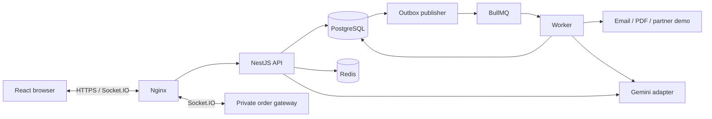

# Hướng dẫn đọc và trình bày dự án ShopFast

Soạn ngày 02/11/2026. Dùng tài liệu này để học luồng code và chuẩn bị phần giải thích; [project tour](22-project-tour.md) là bản mở nhanh thư mục, còn [kịch bản demo](18-defense-walkthrough.md) dành cho thao tác trên ứng dụng.

## 1. Nắm dự án trong một phút

**ShopFast là backend thương mại điện tử theo kiến trúc monolith chia module**, có UI để demo. Các phần chính: xác thực, sản phẩm/tồn kho, giỏ hàng/đơn hàng, hỗ trợ khách hàng bằng Gemini, realtime, cache/rate limit và tác vụ nền. PostgreSQL giữ dữ liệu nghiệp vụ; Redis phục vụ cache, giới hạn truy cập, queue và truyền tín hiệu.

Có thể mở đầu bằng đoạn này:

> Dự án của em là ShopFast, một hệ thống thương mại điện tử dùng NestJS và PostgreSQL. Ngoài luồng mua hàng, em tích hợp theo dõi đơn realtime, Redis cache/rate limit, BullMQ xử lý nền và Gemini hỗ trợ nhân viên chăm sóc khách hàng. Em tổ chức monolith theo module để giữ đơn hàng, tồn kho và outbox trong cùng transaction. API, worker và frontend có entrypoint riêng.

Đọc trước [SRS gốc](../Module%2006%20–%20Software%20Requirement%20Specification%20%28SRS%29.docx.txt), [product spec](01-product-spec.md) và [kiến trúc dữ liệu](02-data-architecture.md). Phân biệt yêu cầu của đề với quyết định bổ sung của dự án; không gọi mọi DEC là yêu cầu nguyên văn SRS.

## 2. Hiểu cây thư mục trước khi đọc từng dòng

| Thư mục             | Vai trò                                                                    | Cách giải thích                                       |
| ------------------- | -------------------------------------------------------------------------- | ----------------------------------------------------- |
| `apps/api`          | Chạy HTTP API và tích hợp realtime                                         | Nơi khởi động và ghép module                          |
| `apps/worker`       | Chạy worker, scheduler, outbox processing                                  | Tách vòng đời xử lý nền khỏi request                  |
| `apps/web`          | React, TypeScript, Vite                                                    | Client gọi HTTP/Socket.IO, không giữ key Gemini       |
| `libs/modules`      | Các module auth/catalog/orders/tickets/ai/jobs/runtime/realtime/operations | Chia theo trách nhiệm nghiệp vụ hoặc hạ tầng ứng dụng |
| `libs/platform`     | Database, config, health, outbox dùng chung                                | Hạ tầng chung, không phụ thuộc ngược module nghiệp vụ |
| `database`          | Migration và seed                                                          | Constraint và lịch sử thay đổi DB                     |
| `tests`             | Unit, contract, integration, runtime, browser                              | Kiểm tra rule, lỗi, race và hành vi người dùng        |
| `harness`           | Chạy kiểm chứng, gom assertion/artifact/receipt                            | Kết quả phải có phạm vi và SHA                        |
| `deploy`            | Docker Linux, Nginx, release, backup, vận hành                             | Code triển khai và khôi phục                          |
| `.github/workflows` | CI và release pipeline                                                     | Kiểm tra PR, build image và triển khai                |
| `docs`              | Spec, quyết định, runbook và evidence                                      | Giải thích thiết kế và minh chứng                     |

Trong một module, đọc theo thứ tự:

```text
http/controller + DTO
        ↓
application/service        quyền nghiệp vụ, validation, transaction, orchestration
        ↓
persistence/repository     SQL và truy cập dữ liệu bằng executor được truyền xuống

composition/runtime        dựng service/adapter, quản lý kết nối và shutdown
adapters                   Gemini, email, PDF hoặc gateway khi module cần
*.module.ts                Nest wiring
*.contracts.ts             type/error contract
```

Không phải module nào cũng cần đủ tất cả thư mục. Đừng giải thích rằng cứ có nhiều tầng hoặc nhiều folder là tự động đạt Clean Code; hãy chỉ vào trách nhiệm và hướng phụ thuộc thực tế.

## 3. Đường đi tổng thể của hệ thống



Khi trình bày, nói rõ đây là sơ đồ logic. Thực tế production hiện tại đặt các thành phần trên một EC2; không phải một cụm nhiều máy hoặc hệ thống HA. Chi tiết mạng, proxy và entrypoint xem [runbook](14-deployment-runbook.md).

## 4. Đọc entrypoint và phần xử lý chung

Mở lần lượt:

1. [API main](../apps/api/src/main.ts): điểm chạy API.
2. [API bootstrap](../apps/api/src/bootstrap.ts): ghép module, validation, xử lý lỗi, response envelope và lifecycle. Tìm `createApiApp`, `ValidationPipe`, `requestId`.
3. [Data source](../libs/platform/src/database/data-source.ts): cấu hình PostgreSQL và migration.
4. [Worker main](../apps/worker/src/main.ts) rồi [FoundationWorker](../apps/worker/src/foundation-worker.ts): khởi tạo và shutdown tiến trình nền.

Điểm cần nói: request có validation và response/lỗi thống nhất; không để mỗi controller tự định dạng tùy ý. Swagger được bật trong bootstrap khi môi trường không phải production; đừng hứa mở Swagger production nếu cấu hình hiện tại không bật.

## 5. Luồng auth: vì sao route được bảo vệ?

**Thứ tự đọc:** [AuthController](../libs/modules/auth/src/http/auth.controllers.ts) → [DTO](../libs/modules/auth/src/http/auth.dto.ts) → [AuthService](../libs/modules/auth/src/application/auth.service.ts) → [AuthRepository](../libs/modules/auth/src/persistence/auth.repository.ts) → [guards](../libs/modules/auth/src/http/auth.guards.ts).

Tìm trong service: `register`, `confirmVerification`, `login`, `refresh`, `currentUser`, `logout`.

Giải thích bằng luồng: đăng ký → lưu password hash → yêu cầu gửi mã qua outbox/job → xác minh email → sử dụng chức năng cần tài khoản đã xác minh. Access token và session còn được kiểm phía server; refresh token được rotate, lịch sử token phục vụ phát hiện reuse.

Ba lớp guard cần hiểu:

- `AccessGuard`: xác thực principal/session.
- `VerifiedGuard`: yêu cầu email đã xác minh.
- `RolesGuard`: kiểm vai trò được phép gọi route.

**Câu cần nói:** “Guard bảo vệ route; service vẫn kiểm quyền trên tài nguyên cụ thể. Khách hàng đăng nhập không có nghĩa là được đọc đơn của người khác.”

**Minh chứng:** [auth integration](../tests/integration/auth.integration.spec.ts), [auth HTTP](../tests/integration/auth-http.integration.spec.ts), [guard unit tests](../tests/unit/auth-guards.spec.ts).

## 6. Luồng quan trọng nhất: checkout và tồn kho

Mở [OrdersController](../libs/modules/orders/src/http/orders.controllers.ts), sau đó [OrderService](../libs/modules/orders/src/application/order.service.ts). Dùng tìm kiếm trong file với `checkout`, `idem`, `transition`, `expireDue`. Khi cần xem SQL, mở [OrderRepository](../libs/modules/orders/src/persistence/order.repository.ts).

Đọc `checkout` theo thứ tự sau:

1. Kiểm danh sách hàng, số lượng và dữ liệu giá client gửi.
2. Chuẩn hóa request và sắp xếp sản phẩm để giữ thứ tự lock nhất quán.
3. Kiểm idempotency: cùng key/cùng payload trả lại kết quả; payload khác gây conflict.
4. Lock và đọc sản phẩm/tồn kho từ DB; kiểm giá, trạng thái bán, lượng còn khả dụng và promotion.
5. Tạo order, snapshot dòng hàng/địa chỉ, reservation và inventory movement; cập nhật giỏ hàng, quota và payment record.
6. Ghi history và outbox trong cùng transaction; sau đó trả đơn đã lưu.

**Ba ý bắt buộc giải thích được:**

- Giá và tồn kho do server xác nhận; client/cache không quyết định có đủ hàng để bán.
- Order/reservation/outbox cùng commit hoặc rollback; repository không tự mở transaction riêng cho từng query.
- Idempotency giải quyết request gửi lại; version và lock giải quyết các thay đổi đồng thời. Chúng có vai trò khác nhau.

Sau đó đọc `transition`: kiểm ownership/role, expected version và trạng thái được phép chuyển. Khi shipping/cancel/expire, xem cách consume hoặc release reservation và ghi movement.

**Câu cần nói:** “Đặt hàng giữ tồn trước. Thanh toán hiện là mô phỏng; em không tích hợp cổng thanh toán thương mại thật.”

**Minh chứng:** [orders integration](../tests/integration/orders.integration.spec.ts) và [catalog/inventory integration](../tests/integration/catalog.integration.spec.ts). Mở tên case về race, oversell, promotion hoặc replay rồi đọc expected/assertion, không chỉ chỉ vào chữ PASS.

## 7. Realtime: đúng người, đúng đơn và kết nối lại

Mở [OrderRealtime gateway](../libs/modules/realtime/src/adapters/realtime.gateway.ts), tìm `/orders`, `order.subscribe`, `subscribe`, `validate`. Sau đó xem [Orders UI](../apps/web/src/features/orders/orders.tsx).

Luồng cần hiểu: handshake nhận token → xác thực session → client đăng ký đơn → server kiểm quyền đọc đơn → join room phù hợp → nhận `order.status.updated`.

Khi mất mạng, client kết nối lại và đăng ký lại; đọc REST để đồng bộ trạng thái DB. Socket event không thay thế DB và không được broadcast mọi đơn cho toàn bộ khách hàng.

**Minh chứng:** [realtime integration](../tests/integration/realtime.integration.spec.ts), [browser purchase/reconnect](../tests/e2e/catalog-live.e2e.spec.ts), [production continuity](evidence/2026-10-29-structure-production.md).

## 8. Background jobs: vì sao request không phải chờ email/PDF?

Đọc [enqueueOutbox và publisher](../libs/platform/src/outbox/outbox.ts) → [FoundationWorker](../apps/worker/src/foundation-worker.ts) → [JobsService](../libs/modules/jobs/src/application/jobs.service.ts) → [JobsRepository](../libs/modules/jobs/src/persistence/jobs.repository.ts).

Tìm `enqueueOutbox`, `consume`, `tick`, `catchUp`, `execute`, `retryDelay`. Theo một event từ lúc ghi DB đến khi được xử lý; phân biệt outbox event với job execution.

- Outbox giữ dấu vết cần xử lý cùng transaction nghiệp vụ.
- Publisher/queue/worker thực hiện tác vụ ngoài request; job có key và trạng thái bền vững.
- Lease, retry và dedup xử lý lỗi/crash; không chỉ dựa vào một biến trong RAM.
- Scheduler có reminder, expiry và revenue report; kiểm clock/timezone trong code và test.

Mở [Resend adapter](../libs/modules/jobs/src/adapters/resend-email.ts), [invoice renderer](../libs/modules/jobs/src/adapters/invoice.renderer.ts), [retention service](../libs/modules/jobs/src/application/retention.service.ts) nếu hội đồng hỏi sâu.

**Câu cần nói:** “Retry không đồng nghĩa gửi lại side effect vô điều kiện. Email cần idempotency và trạng thái delivery; em không hứa exactly-once tuyệt đối với mọi dịch vụ ngoài.”

**Minh chứng:** [jobs](../tests/integration/jobs.integration.spec.ts), [outbox](../tests/integration/outbox.integration.spec.ts), [Resend](../tests/integration/resend.integration.spec.ts), [retention](../tests/integration/retention.integration.spec.ts). Đối tác tồn kho hiện là demo có version/idempotency, không phải đối tác thương mại thật.

## 9. Gemini: công cụ đọc thật và xác nhận của con người

Đọc [TicketsController](../libs/modules/tickets/src/http/tickets.controllers.ts) → [TicketsService](../libs/modules/tickets/src/application/tickets.service.ts) → [AiService](../libs/modules/ai/src/application/ai.service.ts) → [Gemini adapter](../libs/modules/ai/src/adapters/gemini.provider.ts).

Trong `AiService`, tìm:

| Hàm                                  | Điều cần hiểu                                          |
| ------------------------------------ | ------------------------------------------------------ |
| `classify`                           | Phân loại ticket, xử lý version và kết quả lỗi         |
| `createSession` / `session`          | Context gắn ticket và nhân viên được phép dùng         |
| `message` / `executeMessage` / `run` | Xử lý turn, replay và gọi provider/tool trong giới hạn |
| `tool`                               | Validate arguments và truy cập dữ liệu có kiểm quyền   |
| `decide`                             | Xử lý quyết định của người dùng với proposal           |

Hai tool đọc chính là `get_order_status` và `check_inventory`. Chỉ vào nơi tool đọc DB và trả kết quả có provenance/version; không giải thích rằng model tự biết đơn hàng. Backend kiểm context/ownership trước khi trả dữ liệu.

Với proposal ghi dữ liệu: model đề xuất → người có quyền xem và xác nhận → backend validate lại và thực thi. Bản nháp phản hồi không tự được gửi cho khách chỉ vì AI đã tạo xong.

**Câu cần nói:** “Gemini được gọi từ backend bằng key Google AI Studio. Model hỗ trợ phân loại và đề xuất; authorization, transaction và quyết định ghi dữ liệu vẫn ở hệ thống.”

**Minh chứng:** [tickets/AI integration](../tests/integration/tickets-ai.integration.spec.ts), [AI unit tests](../tests/unit/ai-service.spec.ts), [provider tests](../tests/unit/gemini-provider.spec.ts). Đọc cả case ngoài phạm vi, truy cập sai tài nguyên, replay và proposal chưa xác nhận.

Khi demo, giữ quota đã cấu hình. Nếu provider unavailable, nói rõ trạng thái và mở evidence cũ có ngày/SHA; không giả vờ đó là câu trả lời live.

## 10. Cache và rate limit

**Cache:** mở [CatalogService](../libs/modules/catalog/src/application/catalog.service.ts) → [CatalogCache](../libs/modules/runtime/src/catalog-cache.ts) → [catalog invalidation](../libs/modules/runtime/src/catalog-invalidation.ts). Tìm `remember`, `invalidate`, `generation`, `bypass`.

Giải thích cache-aside, invalidation theo phạm vi/tag và chống ghi lại dữ liệu cũ sau invalidation. Khi Redis lỗi, xem fallback/bypass thực tế. Cache tăng tốc tra cứu; transaction mua hàng vẫn đọc DB để bảo vệ tồn và giá.

**Rate limit:** mở [RuntimeRateInterceptor](../libs/modules/runtime/src/http/runtime.interceptor.ts), [RuntimeLimiter](../libs/modules/runtime/src/limiter.ts) và [RuntimeServices](../libs/modules/runtime/src/composition/runtime.runtime.ts). Giải thích lớp giới hạn chung và lớp bảo vệ nghiệp vụ nhạy cảm, 429 và `Retry-After`.

**Minh chứng:** [cache/Redis integration](../tests/integration/cache-redis.integration.spec.ts), [limiter integration](../tests/runtime/limiter.integration.spec.ts), [performance/restore đã đo](evidence/verified-performance-restore.md). Chỉ dùng số p95 theo đúng lần đo và phạm vi trong evidence; không suy ra năng lực 200.000 người đồng thời.

## 11. Frontend và route: mở gì để giải thích nhanh?

1. [main.tsx](../apps/web/src/main.tsx): mount React và BrowserRouter.
2. [App](../apps/web/src/app/App.tsx), [routing](../apps/web/src/app/routing.ts), [navigation](../apps/web/src/app/navigation.tsx): ghép màn hình, session và điều hướng.
3. [API client](../apps/web/src/shared/api/client.ts): gọi API, session refresh và lỗi chung.
4. [features](../apps/web/src/features): mở catalog/cart/orders hoặc tickets theo luồng đang demo.

Giải thích route guard trên UI giúp điều hướng đúng; backend vẫn quyết định quyền. Đừng dùng việc UI giấu nút làm bằng chứng bảo mật. Với giỏ hàng, chỉ vào pending state và cập nhật dữ liệu mà không thay toàn bộ trang.

**Minh chứng:** [route tests](../tests/e2e/routes.e2e.spec.ts), [popup/cart tests](../tests/e2e/product-dialog.e2e.spec.ts), [auth UI tests](../tests/e2e/auth-web.e2e.spec.ts).

## 12. CI/CD, triển khai và cách đọc evidence

Mở [CI workflow](../.github/workflows/ci.yml), [release workflow](../.github/workflows/release.yml), [Dockerfile](../deploy/containers/Dockerfile), [Nginx](../deploy/nginx/nginx.conf), [release script](../deploy/release/deploy-release.sh) và [backup/restore](../deploy/backup).

Trình bày theo luồng: branch → PR → required checks → merge → build/publish image theo SHA → AWS OIDC/SSM → candidate health → promotion; lỗi thì dùng đường phục hồi. DNS thuộc Cloudflare, ứng dụng chạy trên EC2; backup nằm trên S3 tách khỏi máy ứng dụng. Dev Windows dùng PostgreSQL/Memurai native; Docker dành cho Linux CI/VPS.

Khi mở [nghiệm thu release 29/10](evidence/2026-10-29-structure-production.md), nói rõ **đó là lần chạy đã lưu**, không phải kết quả vừa đo hôm nay. Ví dụ ở release `ffcb599`: 68 unit/contract, 69 integration, 19 browser; continuity 57 lượt đọc không lỗi, 3 subscriptions; restore cô lập đã kiểm. Gemini có một lượt unavailable trước khi lượt sau thành công.

Mỗi bằng chứng cần trả lời được: kiểm gì, expected/actual là gì, chạy ở đâu, SHA nào, dữ liệu thật hay fixture, giới hạn nào còn lại. Unit test không chứng minh AWS đã deploy; backup có file không chứng minh restore thành công; health endpoint không chứng minh mọi nghiệp vụ đã chạy.

## 13. Lịch ôn và thứ tự trình bày đề xuất

Nếu có khoảng một giờ để ôn:

| Thời gian  | Việc cần làm                                                |
| ---------- | ----------------------------------------------------------- |
| 0–10 phút  | README, cây thư mục, kiến trúc; tự nói phần mở đầu          |
| 10–25 phút | Theo một request checkout và đọc test race/idempotency      |
| 25–40 phút | Ticket → AI tool → confirmation; order realtime             |
| 40–50 phút | Outbox/worker, cache/limiter, CI và backup                  |
| 50–60 phút | Mở evidence, thử chuyển tab theo kịch bản và tự trả lời Q&A |

Trong phần nói 10 phút: tổng quan 1 phút → mua hàng/realtime 3 phút → AI 2 phút → jobs/cache/limiter 2 phút → CI/restore/evidence và giới hạn 2 phút. Phần source walkthrough không cần đọc hết từng dòng; chọn một luồng và chứng minh được cách nó hoạt động.

## 14. Câu hỏi nên tự trả lời trước buổi trình bày

1. Vì sao giữ monolith nhưng tách API và worker?
2. Controller, application, persistence và composition khác nhau ở đâu trong một request cụ thể?
3. Hai người mua sản phẩm cuối cùng thì DB bảo vệ bằng gì?
4. Bấm đặt hàng hai lần hoặc request timeout rồi gửi lại thì sao?
5. Payment/cancel/expiry đồng thời có làm release tồn hai lần không?
6. Người dùng đoán được order ID của người khác thì server chặn ở đâu?
7. Socket token hết hạn hoặc mất mạng thì client phục hồi bằng gì?
8. Crash sau khi dịch vụ email đã nhận nhưng trước khi job đánh dấu xong thì sao?
9. Gemini dựa vào dữ liệu nào, và ai cho phép thao tác ghi?
10. Redis ngừng chạy thì dữ liệu nào vẫn đáng tin cậy?
11. Test PASS nào dùng mock, test nào dùng DB/Redis thật, test nào chạy trên production?
12. Restore đã kiểm được điều gì? Một EC2 có được gọi là HA không?

Nếu chưa trả lời được câu nào, mở đúng file và test ở các mục trên. Tránh học thuộc một câu trả lời không khớp implementation.

## 15. Checklist trước khi chia sẻ màn hình

- [ ] Mở sẵn README, OrderService, OrderRepository, AiService, gateway, worker và evidence; đóng các tab dư.
- [ ] Mở `.env.example` nếu cần giải thích config; không mở `.env`, `.secrets`, PEM, token hoặc OTP.
- [ ] Đăng nhập đúng vai trò trên các phiên trình duyệt riêng, chuẩn bị luồng customer/warehouse/support/admin.
- [ ] Tự kiểm tra website và tài khoản trước buổi nói; tài liệu này không xác nhận live readiness ngày trình bày.
- [ ] Chọn trước test/case cần mở; không chạy `harness:all`, performance, deploy hoặc restore ngay giữa buổi chỉ để tìm một màn hình PASS.
- [ ] Nêu rõ thanh toán mô phỏng, đối tác demo và các gate chưa nghiệm thu trong [delivery status](20-delivery-status.md)/[completion plan](16-srs-completion-plan.md).
- [ ] Mở được [slide](defense/README.md) và evidence dự phòng nếu mạng/provider không ổn định.

Nếu cần chạy checks local trước buổi, dùng các lệnh trong `package.json`: `npm run architecture:check`, `npm test`, `npm run build`, `npm run test:integration`, `npm run test:e2e`. Integration/browser cần database test và Redis test được cấu hình đúng; xem [README](../README.md) và [harness guide](17-harness-guide.md), không trỏ test vào DB production.
