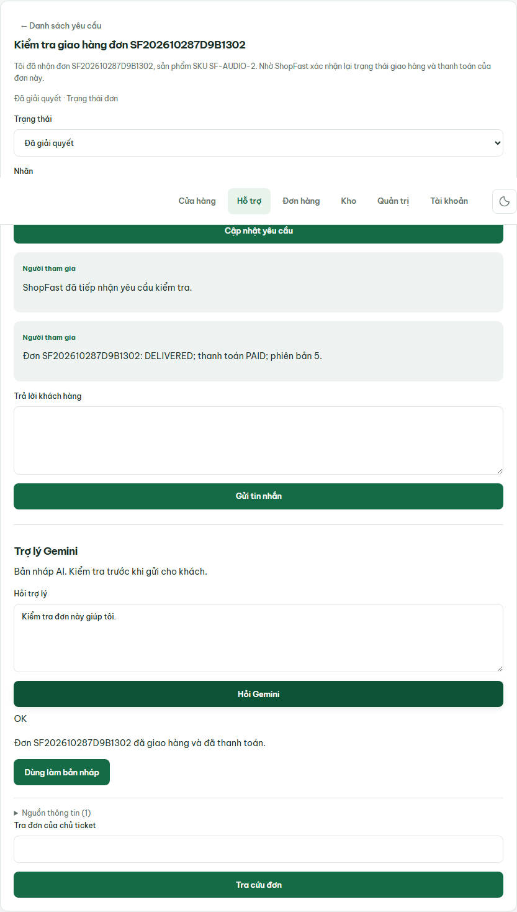

# Vietnamese assistant wording production check — 2026-11-02

Deployed commit: `378b747890f40328d67dd2d5a57c6170967fbbf2`.
Application digest:
`sha256:d62ece299ff0e3166ac36fecfced501474d22a45554bb4f18adaad5945201f5f`.
URL: <https://shopfast.tuanpq.com>.

- [PR 26](https://github.com/tuanpham2xx3/shopfast-module6/pull/26): merged after Application and Docs checks passed.
- [PR Application CI](https://github.com/tuanpham2xx3/shopfast-module6/actions/runs/41387462653): PASS.
- [Release](https://github.com/tuanpham2xx3/shopfast-module6/actions/runs/41388066518): PASS; promotion 20 seconds, previous release f118ed9 retained.
- Pre-release backup: `shopfast-20261102T041649Z.dump`.
- Exact merged source selected on VPS 15.135.168.32.

Real Gemini HTTP and Chromium checks used the user's example order
SF202610287D9B1302 and a fresh assistant turn asking “Kiểm tra đơn này giúp tôi.”
Both returned OK, with get_order_status evidence DELIVERED/PAID and this exact
visible answer:

> Đơn SF202610287D9B1302 đã giao hàng và đã thanh toán.

Assertions confirmed no DELIVERED, PAID or “phiên bản” in answer text. Technical
DB evidence remains unchanged. The ticket had been resolved through normal use;
verification preserved RESOLVED rather than resetting it to the previous fixture
state. Historical stored assistant answers were not rewritten.

