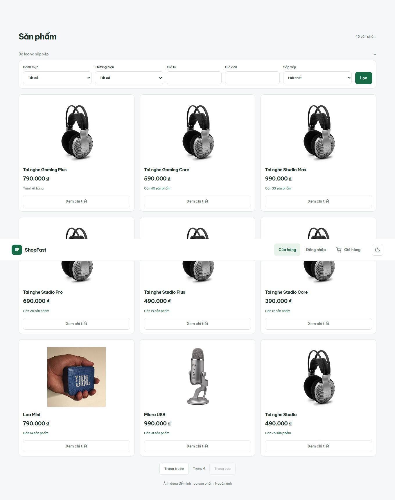

# Demo catalog pagination — 2026-11-02

Production data expanded through the existing authenticated Admin/Inventory API.
No application image deployment or DB schema change was needed.

- Baseline public catalog: 3 products, frontend page size 12.
- Pre-operation backup uploaded: `shopfast-20261102T081512Z.dump`.
- Dry-run: 42 missing demo SKUs, zero existing.
- Apply: 42 created, 36 inventory initializations, six intentionally out of stock.
- Repeat apply: zero created, 42 skipped, zero inventory mutations.
- Public catalog now has 45 active products. Existing products/prices/stock were
  preserved. Product descriptions explicitly identify fictional demo variants;
  photos are existing licensed category illustrations.

## Real API verification

- Pages 1–4 with pageSize 12: **12 / 12 / 12 / 9**.
- 45 unique product IDs across all pages, no repeated IDs.
- 42 new demo products, six with zero available stock.
- Tai nghe / Loa / Micro each have 14 products; filtered page 2 returns two items.
- Ascending price sort verified across all 45 products.
- All three distinct image URLs returned HTTP 200 and image content types.

## Real browser verification

Chromium opened the public product page, navigated through all four pages,
verified counts and the disabled next button on page 4, then filtered Tai nghe
and verified 12 / 2 items across its two pages. Visible last-page images loaded.

The first browser run reached page 4 but its filter step failed because the test
used an exact accessible label that did not match the wrapped select. Repeated
the check using the actual category select and the complete flow passed; no UI
code or product rule was changed to make it pass.

The defense deck catalog screenshot and PDF were refreshed to show the expanded
catalog. The renderer passed all ten screen/print slides, ten PDF pages, font/image
loads, keyboard/notes and viewport checks. Source fixture scripts passed syntax
and format checks. No checkout or full SRS acceptance is inferred from these
pagination checks. Existing AuthService edits are excluded.
