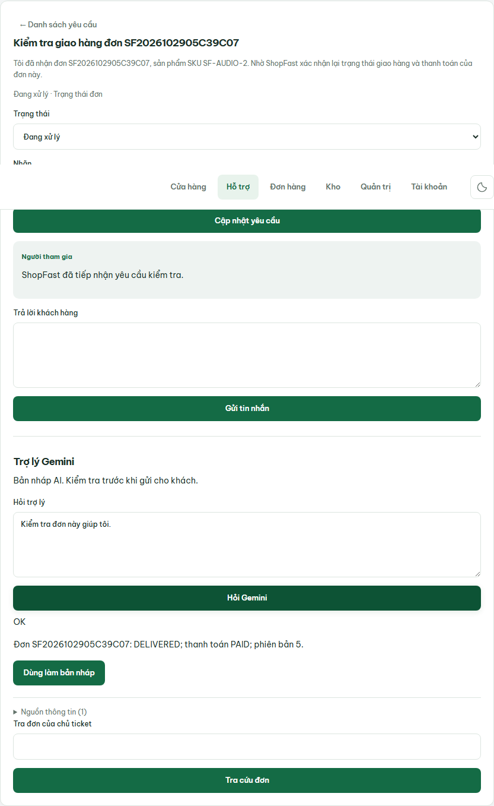

# Repair incomplete demo ticket context — 2026-11-02

Application remains on `f118ed9c8f4a1f8f061b6c7ecf0281e3c9835818`.
This is a fixture repair, not a new application image deployment.

The staging harness created tickets titled “Harness order support” with a generic
body and no orderId, even though checkout had already produced a delivered, paid
order for the same synthetic customer. Corrected the harness payload to include
orderId, a Vietnamese subject containing the actual order code, product SKU in
the body, and a specific acknowledgment. Ticket creation asserts the returned
order link. Staging SSH target can be overridden with SHOPFAST_SSH_TARGET.

## Production data operation

- Backup uploaded before changes: `shopfast-20261102T035611Z.dump`.
- Ran `deploy/fixtures/repair-staging-tickets.cjs` via stdin inside the current
  application container. Dry-run first found 16 eligible records, zero ambiguous
  cases. Applied one transaction: 16 repaired, zero skipped.
- Eligibility requires synthetic customer display name, exact old subject/body,
  no existing order link, and an open/in-progress ticket. A customer must have
  exactly one existing order, with DELIVERED/PAID and order item SKU snapshots.
- Links use that customer's order only. No order, payment, inventory or invoice
  was rewritten. Assigned OPEN fixtures move to IN_PROGRESS. Existing category
  decisions and conversation history are preserved.
- Each repair increments ticket version and writes DEMO_FIXTURE_REPAIRED audit
  with before/after data. Old proposals must still pass their version checks.
- Second dry-run: zero eligible records (no repeat mutation).
- SQL verification: 16 repaired ticket/order links, zero ownership mismatches,
  16 DELIVERED/PAID orders and 16 bodies containing their linked order code.

## End-to-end verification

Repaired ticket `e4c97867-bd7a-4d99-8190-9cc1f048c2f2` is now
“Kiểm tra giao hàng đơn SF2026102905C39C07”. Authenticated detail and linked-order
lookup returned IN_PROGRESS and the correct DELIVERED/PAID order.

Sent only “Kiểm tra đơn này giúp tôi.” through the real Gemini HTTP flow and a
real Chromium browser. Both returned OK with get_order_status evidence for
SF2026102905C39C07, status DELIVERED and payment PAID. No order code was manually
provided in the assistant question.

Source checks: repair and staging JavaScript syntax PASS; harness source/format
check PASS; harness self-tests 22/22 PASS. The entire staging checkout/email flow
was not rerun. Existing uncommitted AuthService relocation changes are excluded.
